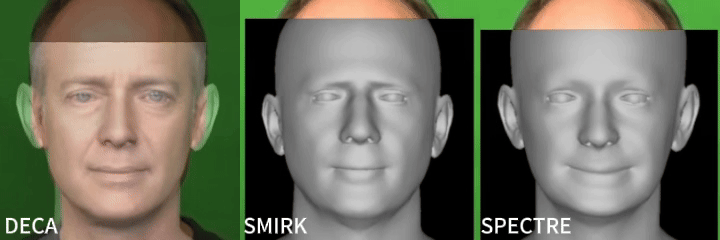
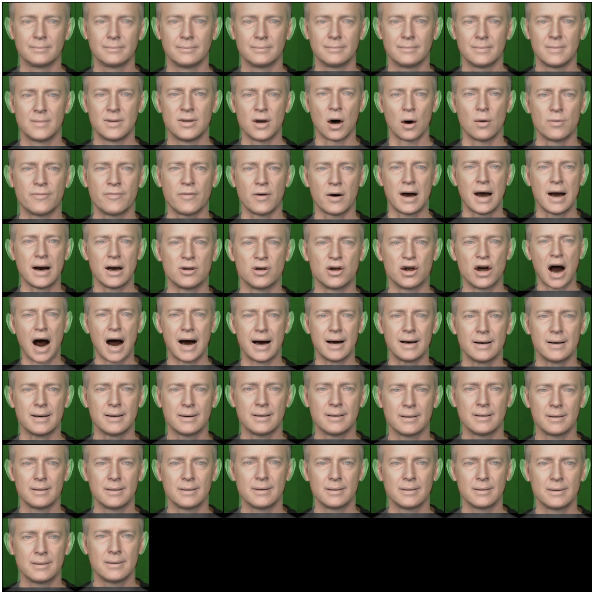
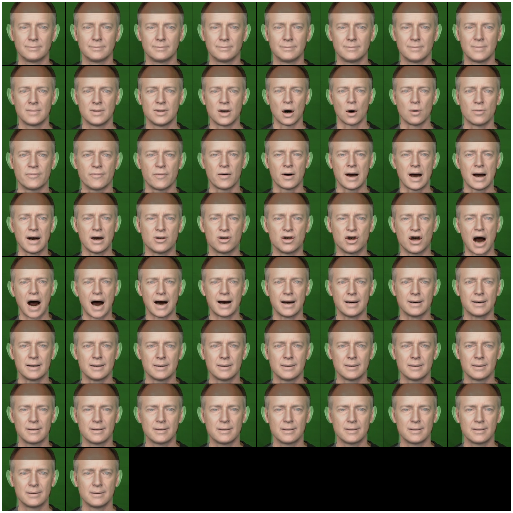

<div align="center">
  
</div>

---

<div align="center">
  
</div>

<p align="center">
🤩A PyTorch-based toolkit for 3D face parameterization and reconstruction, integrating multiple face models.🤩
</p>


## 🔥 Updates

- [2026.10.26] Release [Deep3DFaceRecon](https://github.com/sicxu/Deep3DFaceRecon_pytorch), [Deep3DFaceRecon's BFM](https://github.com/sicxu/Deep3DFaceRecon_pytorch), and [Deep3DFaceRecon's Nvduffrast-based renderer](https://github.com/sicxu/Deep3DFaceRecon_pytorch).
- [2026.10.26] Release [MediaPipe Blendshapes to FLAME](https://github.com/PeizhiYan/mediapipe-blendshapes-to-flame), [DECA](https://github.com/yfeng95/DECA), [MICA](https://github.com/Zielon/MICA), [SMIRK](https://github.com/georgeretsi/smirk), and [SPECTRE](https://github.com/filby89/spectre).
- [2026.10.26] Release [FLAME](https://github.com/soubhiksanyal/FLAME_PyTorch).
- [2026.10.26] 🎉 Release [face3d_pytorch](https://github.com/tlemangen/face3d_pytorch).

## 📄 TODO

- Parameterizer
    - FLAME-based
        - [x] [MediaPipe Blendshapes to FLAME](https://github.com/PeizhiYan/mediapipe-blendshapes-to-flame)
        - [x] [DECA](https://github.com/yfeng95/DECA)
        - [x] [MICA](https://github.com/Zielon/MICA)
        - [x] [SMIRK](https://github.com/georgeretsi/smirk)
        - [x] [SPECTRE](https://github.com/filby89/spectre)
        - [ ] [EMOCA](https://github.com/radekd91/emoca)
        - [ ] [INFERNO](https://github.com/radekd91/inferno)
        - [ ] ...
    - BFM-based
        - [x] [Deep3DFaceRecon](https://github.com/sicxu/Deep3DFaceRecon_pytorch)
        - [ ] ...
- 3DMM
    - [x] [FLAME](https://github.com/soubhiksanyal/FLAME_PyTorch)
    - BFM
        - [x] [Deep3DFaceRecon's BFM](https://github.com/sicxu/Deep3DFaceRecon_pytorch)
        - [ ] ...
- Renderer
    - [x] [Deep3DFaceRecon's Nvduffrast-based renderer](https://github.com/sicxu/Deep3DFaceRecon_pytorch)
    - [ ] ...
- Applications
    - [ ] Face Reconstruction
    - [ ] Face Reenactment
    - [ ] ...

## 📖 Quick Start

### 🔗 Download Assets

Download the assets from [here]() and place them in the project as follows:

```markdown
face3d_pytorch
|- assets
`- face3d_pytorch
   |- asssets                   // here
   |  |- blendshapes_to_flame
   |  |- deca
   |  `- ...
   `- core
```

### 📝 Useage

Load a video:
```python
from torchvision.io import read_video

video, _, _ = read_video(filename, output_format="TCHW")
video = (video / 255.0).to(torch.float32).cuda()
# (58, 3, 256, 256), torch.float32
```

Load DECA:

```python
from face3d_pytorch.core.parameterizer.deca import DECAWrapper

deca = DECAWrapper(
    flame_encoder_checkpoints="face3d_pytorch/assets/deca/flame_encoder.pth",
    detail_encoder_checkpoints="face3d_pytorch/assets/deca/detail_encoder.pth",
    detail_decoder_checkpoints="face3d_pytorch/assets/deca/detail_decoder.pth",
)
deca.eval().cuda()
```

Inference:

```python
params_dict, align_dict = deca(video)

for k, v in params_dict.items():
    print(f"{k}: {v.shape}")
# shape: torch.Size([58, 100])
# tex: torch.Size([58, 50])
# exp: torch.Size([58, 50])
# pose: torch.Size([58, 6])
# cam: torch.Size([58, 3])
# light: torch.Size([58, 9, 3])
# detail: torch.Size([58, 128])
# uv_z: torch.Size([58, 1, 256, 256])

for k, v in align_dict.items():
    print(f"{k}: {v.shape}")
# aligned_images: torch.Size([58, 3, 224, 224])
# align_params: torch.Size([58, 3, 3])
```

Load FLAME:

```python
from face3d_pytorch.core.d3mm.flame import FLAMEWrapper

shape = params_dict["shape"]
exp = params_dict["exp"]
pose = params_dict["pose"]

flame = FLAMEWrapper(
    flame_model_path="face3d_pytorch/assets/flame/FLAME2020/generic_model.pkl",
    static_landmark_embedding_path="face3d_pytorch/assets/flame/flame_static_embedding.pkl",
    dynamic_landmark_embedding_path="face3d_pytorch/assets/flame/flame_dynamic_embedding.npy",
    batch_size=images.shape[0],
    shape_params=shape.shape[-1],
    expression_params=exp.shape[-1],
    pose_params=pose.shape[-1],
).cuda()

mesh_dict = flame(shape, exp, pose)

for key, value in mesh_dict.items():
    print(f"{key}: {value.shape}")
# verts: torch.Size([58, 5023, 3])
# faces: torch.Size([9976, 3])
# landmarks: torch.Size([58, 68, 3])
```

Visualization:

```python
import matplotlib.pyplot as plt
from torchvision.utils import make_grid

from face3d_pytorch.core.d3mm.utils import render_shape

renderred_mesh = render_shape(vertices=mesh_dict["verts"], faces=mesh_dict["faces"], cam=params_dict["cam"], image_size=224)
aligned_images = align_dict["aligned_images"]
renderred = 0.5 * aligned_images + 0.5 * renderred_mesh

plt.figure(figsize=(40, 40))
plt.imshow(make_grid(renderred, nrow=8).permute(1, 2, 0).detach().cpu().numpy())
plt.axis("off")
```



Inverse-align to original coordinates:

```python
from face3d_pytorch.core.preprocessing.face_alignment import deca_inverse_align

out = deca_inverse_align(renderred_mesh, align_dict["align_params"], output_size=(256, 256))
out = 0.5 * images + 0.5 * out
plt.figure(figsize=(40, 40))
plt.imshow(make_grid(out, nrow=8).permute(1, 2, 0).detach().cpu().numpy())
plt.axis("off")
```



## License

This project is licensed under the [Apache License 2.0](LICENSE).
